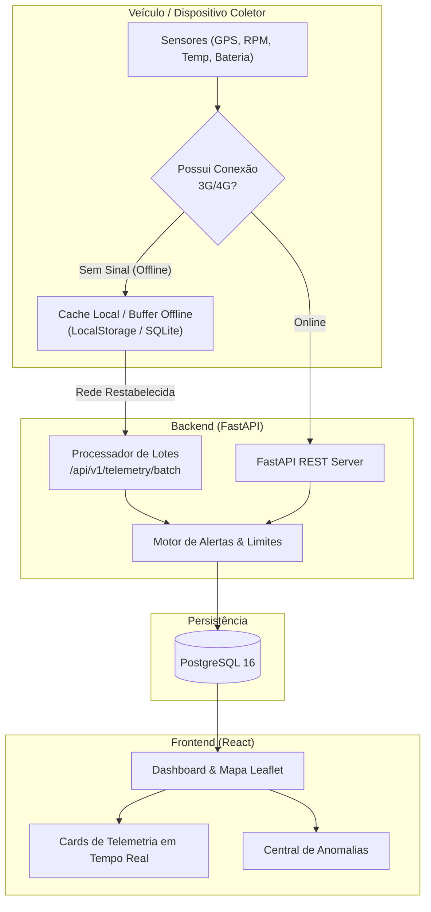
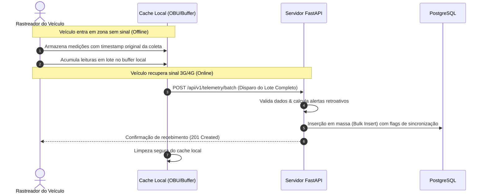

# EcoFleet — Sistema de Telemetria Veicular & Gestão de Frotas (Offline-First)

Projeto Full-Stack desenvolvido com **Python (FastAPI)**, **React (TypeScript)**, **PostgreSQL** e **Docker**, focado em telemetria veicular, detecção de anomalias em tempo real e **tolerância a falhas em cenários de conectividade reduzida (Offline-First)**.

---

## Motivação & Alinhamento com o Edital

Este projeto foi desenhado sob medida para demonstrar proficiência nos requisitos de desenvolvimento do edital:
1. **Telemetria Veicular:** Coleta, processamento georreferenciado (GPS), velocidade, rotação (RPM), temperatura de motor e nível de combustível.
2. **Conectividade Reduzida (Offline-First):** Estratégia de enfileiramento local no dispositivo/cliente (buffer local) quando não há sinal de dados (3G/4G) e sincronização em lote (`POST /api/v1/telemetry/batch`) com preservação do timestamp original de captura ao restaurar conexão.
3. **Backend com Python (FastAPI):** APIs RESTful com validação estrita (Pydantic v2), ORM (SQLAlchemy), autenticação segura (JWT) e documentação OpenAPI/Swagger automática.
4. **Frontend Moderno:** React + TypeScript + Tailwind CSS + Mapas interativos (Leaflet / OpenStreetMap) mapeando as rotas da frota no campus da UFRN (Natal/RN).
5. **DevOps & Containers:** Orquestração completa com `docker-compose` (Banco de Dados + API + Frontend).

---

## Arquitetura do Sistema



---

## Fluxo de Tolerância a Quedas de Conexão (Offline-First)

Quando o veículo entra em uma zona de sombra (ex: túneis, rodovias remotas ou subsolos):



---

## Como Executar o Projeto

Você pode rodar o projeto de forma rápida via **Docker Compose** ou em **Ambiente de Desenvolvimento Local**.

### Opção 1: Execução com Docker Compose (Recomendado)

Certifique-se de ter o Docker e Docker Compose instalados e execute na raiz do projeto:

```bash
docker compose up --build
```

Acesse:
* **Frontend (Painel de Gestão):** [http://localhost:3000](http://localhost:3000)
* **Backend API:** [http://localhost:8000](http://localhost:8000)
* **Documentação Interativa (Swagger):** [http://localhost:8000/docs](http://localhost:8000/docs)

---

### Opção 2: Execução em Desenvolvimento Local

#### 1. Backend (FastAPI)
```bash
cd backend

# Crie e ative o ambiente virtual
python3 -m venv .venv
source .venv/bin/activate  # No Windows: .venv\Scripts\activate

# Instale as dependências
pip install -r requirements.txt

# Inicie o servidor FastAPI (usa SQLite automaticamente se não houver Postgres rodando)
uvicorn app.main:app --reload --port 8000
```
> O backend iniciará na porta **8000** e criará o banco de dados e dados de teste da UFRN automaticamente.

#### 2. Frontend (React + Vite)
Em outro terminal:
```bash
cd frontend

# Instale os pacotes npm
npm install

# Inicie o servidor de desenvolvimento
npm run dev
```
> O frontend iniciará em [http://localhost:5173](http://localhost:5173).

---

## Principais Endpoints da API

| Método | Rota | Descrição |
| :--- | :--- | :--- |
| `GET` | `/api/v1/vehicles` | Lista todos os veículos da frota com a última telemetria |
| `POST` | `/api/v1/vehicles` | Cadastra um novo veículo na frota |
| `POST` | `/api/v1/telemetry` | Ingestão individual em tempo real |
| `POST` | `/api/v1/telemetry/batch` | **Ingestão em lote de medições acumuladas offline** |
| `GET` | `/api/v1/telemetry/vehicles/{id}/trajectory` | Retorna o trajeto georreferenciado ordenado |
| `GET` | `/api/v1/telemetry/alerts` | Lista alertas de excesso de velocidade, superaquecimento, etc. |
| `PATCH`| `/api/v1/telemetry/alerts/{id}/resolve` | Marca anomalia como resolvida |
| `POST` | `/api/v1/seed` | Popula dados de demonstração no Campus Central da UFRN |

### Exemplo de Payload para Sincronização em Lote (`POST /api/v1/telemetry/batch`):
```json
{
  "items": [
    {
      "vehicle_id": 1,
      "recorded_at": "2026-11-10T14:30:00Z",
      "latitude": -5.8385,
      "longitude": -35.2095,
      "speed": 85.5,
      "rpm": 2850,
      "fuel_level": 74.0,
      "engine_temp": 95.0,
      "battery_voltage": 12.5,
      "odometer": 14245.0,
      "is_offline_sync": true
    }
  ]
}
```

---

## Funcionalidades Demonstradas no Frontend

1. **Simulador de Conectividade:** Botão para alternar entre *Online (3G/4G)* e *Offline (Zona de Sombra)*.
2. **Buffer Local:** Acúmulo de leituras em cache local enquanto offline.
3. **Descarregamento de Lote (Batch Sync):** Transmissão do pacote acumulado em requisição única ao restabelecer conexão.
4. **Mapa Dinâmico (Leaflet):** Traçado contínuo da rota com marcadores coloridos diferenciando transmissões em tempo real de transmissões vindas do cache offline.
5. **Gauges de Telemetria:** Velocímetro, RPM, Nível do Tanque, Temperatura do Motor e Tensão da Bateria.

---

## Dados de Acesso (Seed)
* **Usuário Padrão:** `gestor@ufrn.br`
* **Senha:** `senha123`
